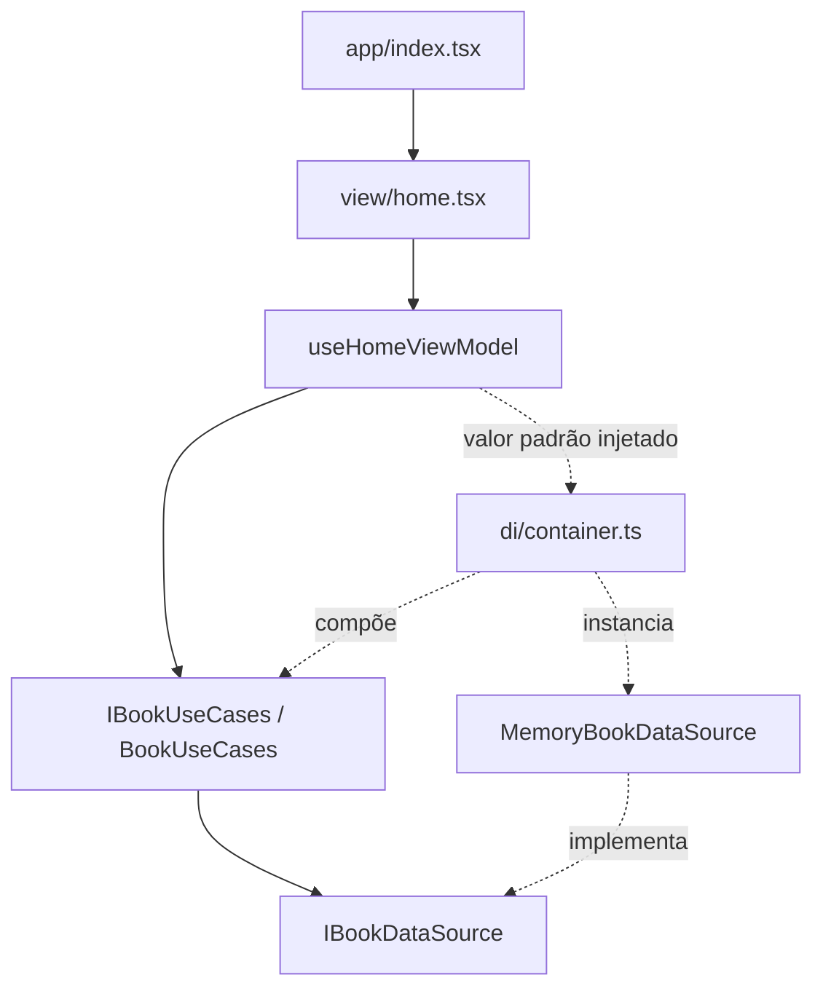

# Arquitetura MVVM sofisticado

A decisão está registrada no [ADR 0002](adr/0002-adotar-expo-mvvm.md). O nome da skill é `skill_mvvm_simplificado`, mas o padrão aplicado é o MVVM sofisticado com sete camadas.

## Responsabilidades

| Camada | Responsabilidade | Exemplo real | Não deve fazer |
| --- | --- | --- | --- |
| `app` | Rotas e configuração de navegação | [index.tsx](../src/app/index.tsx) | Regras de negócio ou acesso a dados |
| `view` | Renderização e captura de eventos | [home.tsx](../src/view/home.tsx) | Chamar infraestrutura, validar negócio ou capturar exceções |
| `viewmodel` | Estado e ações da tela; navegação quando necessária | [useHomeViewModel.ts](../src/viewmodel/useHomeViewModel.ts) | Conhecer implementação de persistência ou renderizar JSX |
| `usecase` | Operações da aplicação e validações de negócio quando existirem | [bookUseCases.ts](../src/usecase/bookUseCases.ts) | Depender de React ou de SDK externo |
| `model` | Entidades, contratos e erros puros | [book.ts](../src/model/entities/book.ts) | Depender de UI ou infraestrutura |
| `infra` | Implementar contratos com tecnologia concreta | [memoryBookDataSource.ts](../src/infra/datasources/memoryBookDataSource.ts) | Definir fluxo de tela |
| `di` | Construir e conectar implementações | [container.ts](../src/di/container.ts) | Concentrar regras de negócio |

`app/_layout.tsx` configura o Stack; `app/index.tsx` reexporta a View. As pastas `model/services` e `infra/services` estão reservadas e não contêm serviços implementados.

## Fluxo da tela inicial



Ao montar a tela, o hook chama `listBooks()`. O caso de uso delega a `list()` do datasource recebido no construtor. O datasource padrão retorna uma lista vazia. Quando resolve, o hook entrega o estado à View. Esta mostra lista, ausência de dados, carregamento ou erro.

O container exporta uma instância compartilhada de `IBookUseCases`. Nos testes, a ViewModel recebe uma implementação alternativa pelo argumento; não é necessário conectar banco nem rede. Não existe seleção de backend porque só há a implementação em memória.

## Contratos e modelo atual

```typescript
type Book = Readonly<{
  id: string;
  title: string;
  author: string;
  status: "available" | "reserved";
}>;
// IBookDataSource
list(): Promise<readonly Book[]>;
// IBookUseCases
listBooks(): Promise<readonly Book[]>;
```

Este é um resumo dos contratos, não um arquivo TypeScript completo. Os identificadores e textos são strings; não há validação de formato, unicidade ou conteúdo em tempo de execução. O `id` é usado como chave da lista. Título e autor são exibidos na tela. `status` indica se o anúncio está `available` ou `reserved`; a transição para reservado será aplicada pelos casos de uso da negociação, ainda não implementados. Não há proprietário, ISBN, arquivo digital ou localização no modelo atual.

`readonly` protege usos no TypeScript, não congela objetos em tempo de execução. O datasource copia os livros na entrada e na saída para que alterações externas não modifiquem sua lista interna. Não há operação de gravação; os dados desaparecem ao encerrar a execução.

## Estado e concorrência

`HomeState` contém `books`, `loading` e `error`. `HomeActions` expõe `reload()`. O hook retorna `[state, actions]`.

- A primeira renderização inicia carregando; a montagem dispara a consulta.
- Uma nova tentativa limpa o erro e ativa carregamento. Os livros anteriores permanecem no estado, mas a View prioriza o indicador enquanto carrega.
- No sucesso, substitui a lista e limpa o erro.
- Na falha, encerra o carregamento e fornece mensagem amigável.
- Um contador identifica a consulta mais recente: respostas antigas não sobrescrevem o estado atual.
- Ao desmontar, o hook invalida resultados pendentes. Isso não cancela a operação de dados; apenas evita aplicar seu resultado.

## Autenticação (specs/003, trilha da Maria Clara)

Contratos: `User` (`id`, `email`, sem senha) em [user.ts](../src/model/entities/user.ts);
`IAuthDataSource` (`signUp`, `signIn`, `signOut`, `currentUser`) e `IAuthUseCases` (mesmos nomes,
exceto `getSession` no lugar de `currentUser`). `MemoryAuthDataSource` guarda contas por e-mail
normalizado (minúsculo, sem espaços) e a sessão atual em memória; lança `AuthError` para e-mail
duplicado (FR-002) e para credenciais inválidas, sem revelar se o e-mail existe. `AuthUseCases`
valida formato de e-mail e tamanho mínimo de senha (`authValidator.ts`, FR-001) antes de delegar
ao datasource. `di/container.ts` expõe `authUseCases` ao lado de `bookUseCases`.

`useAuthViewModel` segue o mesmo formato de `useHomeViewModel` (`[state, actions]`, injeção do
caso de uso por parâmetro para testes). Para manter `src/view/**` testável sem depender de
`expo-router` (não há mock dessa biblioteca em `tests/`), a navegação após autenticar ou entre
telas de entrar/criar conta é feita por callbacks (`onAuthenticated`, `onNavigateToSignUp`,
`onNavigateToSignIn`) recebidos como props; quem resolve esses callbacks com `expo-router` são as
rotas finas em `src/app/entrar.tsx`, `src/app/criar-conta.tsx` e `src/app/index.tsx` (que deixou
de ser um reexport puro e passa `onNavigateToSignIn` para `Home`). `src/view/home.tsx` também usa
`useAuthViewModel` para mostrar "Olá, {e-mail}" + botão "Sair" quando autenticado, ou um link
"Entrar" quando visitante — o botão "Anunciar" ainda está pendente e será concluído em
coordenação com Antonio (Tarefa 24).

Cadastro de anúncio (US2, modalidade/preço, `createListing`) ainda não está implementado — ver
[specs/003/tasks.md](../specs/003-autenticacao-e-cadastro-de-anuncio/tasks.md).

## Erros

[errors.ts](../src/model/errors.ts) define `DomainError`, `ValidationError`, `AuthError` e `DataSourceError`. A ViewModel apresenta a mensagem de `DomainError`; erros inesperados recebem mensagem genérica. Portanto, mensagens de domínio devem ser seguras para exibição ao usuário.

`AuthError` e `ValidationError` já são usados na autenticação; a validação de cadastro de anúncio
ainda não existe. Infraestruturas futuras devem converter erros externos em erros de domínio. A
implementação atual em memória não integra biblioteca externa de dados.

## Convenções e limites da automação

Usar alias `@/` para `src`, interfaces `I...` em arquivos `i...` e hooks `use...ViewModel`. Dependências concretas de infraestrutura são compostas em `di/container.ts`; testes podem importar implementações.

[O verificador](../scripts/verificar-arquitetura.mjs) inspeciona imports, reexports, `require` e imports dinâmicos literais em `src`. Rejeita dependências externas em domínio/casos de uso e relações entre camadas fora da matriz definida no script. Não analisa regras de negócio, toda a semântica dos hooks nem qualquer forma possível de acesso indireto. Revisão de código continua necessária.

## Evoluir a arquitetura

Para uma nova operação: especificação e critérios de aceite → modelo/contratos → caso de uso → infraestrutura → container → ViewModel → View → rota. Registrar ADR antes de escolher banco, autenticação ou integração relevante. Não criar serviços, classes ou entidades apenas para preencher pastas.
