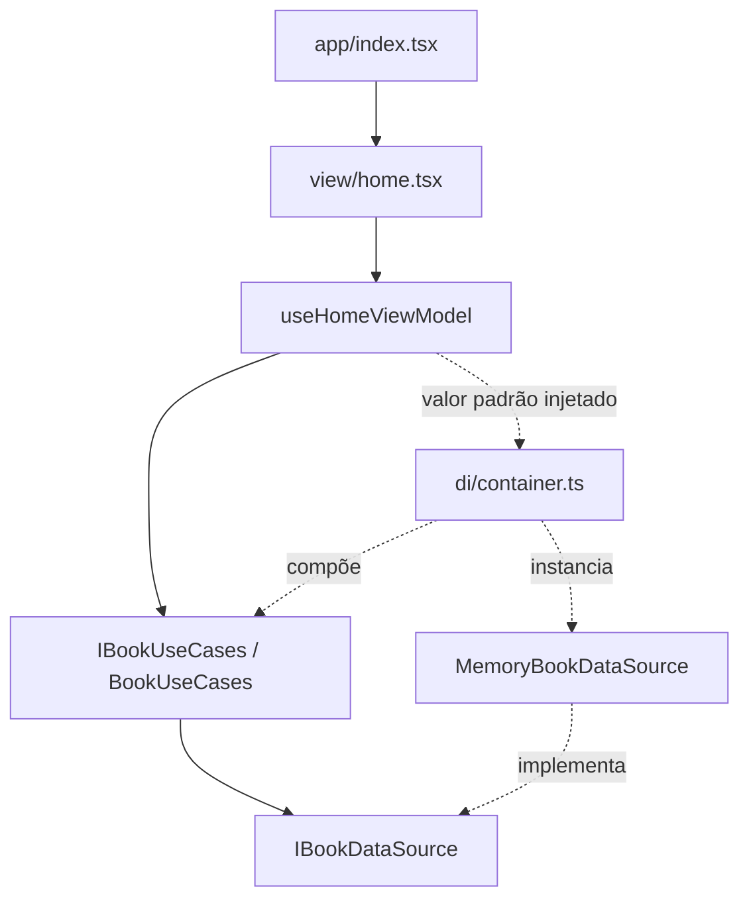

# Arquitetura MVVM sofisticado

> Atualização de 2026-10-23: `src/infra/datasources` tem implementações em memória e Supabase
> para cada contrato (contas, anúncios, pedidos, encontros, favoritos, alertas, notificações,
> denúncias, perfis, avaliações, fotos, preferências e exportação LGPD), além de adaptadores
> `AsyncStorage` (onboarding, histórico de buscas, tema) e `NetInfo` (conectividade).
> `di/container.ts` escolhe o Supabase quando `EXPO_PUBLIC_BACKEND=supabase` (fora de testes);
> caso contrário, usa memória. As seções abaixo descrevem a origem de cada fluxo e podem citar o
> estado da época em que foram escritas. O fluxo de senha temporária foi removido pela spec 007.

A decisão está registrada no [ADR 0002](adr/0002-adotar-expo-mvvm.md). O nome da skill é `skill_mvvm_simplificado`, mas o padrão aplicado é o MVVM sofisticado com sete camadas.

## Responsabilidades

| Camada | Responsabilidade | Exemplo real | Não deve fazer |
| --- | --- | --- | --- |
| `app` | Rotas e configuração de navegação | [index.tsx](../src/app/index.tsx) | Regras de negócio ou acesso a dados |
| `view` | Renderização e captura de eventos | [home.tsx](../src/view/home.tsx) | Chamar infraestrutura, validar negócio ou capturar exceções |
| `viewmodel` | Estado e ações da tela; navegação quando necessária | [useHomeViewModel.ts](../src/viewmodel/useHomeViewModel.ts) | Conhecer implementação de persistência ou renderizar JSX |
| `usecase` | Operações da aplicação e validações de negócio quando existirem | [bookUseCases.ts](../src/usecase/bookUseCases.ts) | Depender de React ou de SDK externo |
| `model` | Entidades, contratos e erros puros | [book.ts](../src/model/entities/book.ts) | Depender de UI ou infraestrutura |
| `infra` | Implementar contratos com tecnologia concreta | [memoryBookDataSource.ts](../src/infra/datasources/memoryBookDataSource.ts) | Definir fluxo de tela |
| `di` | Construir e conectar implementações | [container.ts](../src/di/container.ts) | Concentrar regras de negócio |

`app/_layout.tsx` configura o Stack; `app/index.tsx` reexporta a View. `model/services` define contratos de serviços transversais (`ILogger`, `IRateLimiter`, `IFileDownloadService`, `IPwaService`), implementados em `infra/services` (`SafeLogger`, `ClientRateLimiter`, download de arquivos, otimização de imagens e PWA).

## Fluxo da tela inicial



Ao montar a tela, o hook chama `listBooks()`. O caso de uso delega a `list()` do datasource recebido no construtor. O datasource padrão retorna uma lista vazia. Quando resolve, o hook entrega o estado à View. Esta mostra lista, ausência de dados, carregamento ou erro.

O container exporta uma instância compartilhada de `IBookUseCases`. Nos testes, a ViewModel recebe uma implementação alternativa pelo argumento; não é necessário conectar banco nem rede. O backend (memória ou Supabase) é escolhido no container, conforme a nota no topo deste documento.

## Contratos e modelo atual

```typescript
type Book = Readonly<{
  id: string;
  title: string;
  author: string;
  status: "available" | "reserved";
  modality: "sale" | "trade" | "donation";
  price?: number; // obrigatório e > 0 só quando modality === "sale" (FR-005)
  ownerId: string;
}>;
// IBookDataSource
list(): Promise<readonly Book[]>;
create(input): Promise<Book>;
// IBookUseCases
listBooks(): Promise<readonly Book[]>;
createListing(input: CreateListingInput, sessionUserId: string | null): Promise<Book>;
```

Este é um resumo dos contratos, não um arquivo TypeScript completo. O `id` é usado como chave da
lista. Título, autor e a tag de modalidade (Venda/Troca/Doação) são exibidos na tela. `status`
indica se o anúncio está `available` ou `reserved`; a transição para reservado é aplicada
pelos casos de uso da negociação (`BookRequestUseCases.respondToRequest` com aceite). `createListing` exige
`sessionUserId` não nulo (FR-006) e valida o payload com `bookValidator` antes de gravar; o
anúncio criado é associado à conta autenticada via `ownerId`. Não há ISBN, arquivo digital ou
localização no modelo atual.

`readonly` protege usos no TypeScript, não congela objetos em tempo de execução. O datasource em memória copia os livros na entrada e na saída para que alterações externas não modifiquem sua lista interna; seus dados desaparecem ao encerrar a execução. A persistência real fica no `SupabaseBookDataSource`.

## Estado e concorrência

`HomeState` contém `books`, `loading` e `error`. `HomeActions` expõe `reload()`. O hook retorna `[state, actions]`.

- A primeira renderização inicia carregando; a montagem dispara a consulta.
- Uma nova tentativa limpa o erro e ativa carregamento. Os livros anteriores permanecem no estado, mas a View prioriza o indicador enquanto carrega.
- No sucesso, substitui a lista e limpa o erro.
- Na falha, encerra o carregamento e fornece mensagem amigável.
- Um contador identifica a consulta mais recente: respostas antigas não sobrescrevem o estado atual.
- Ao desmontar, o hook invalida resultados pendentes. Isso não cancela a operação de dados; apenas evita aplicar seu resultado.

## Autenticação (specs/003, trilha da Maria Clara)

Contratos: `User` (`id`, `email`, sem senha) em [user.ts](../src/model/entities/user.ts);
`IAuthDataSource` (`signUp`, `signIn`, `signOut`, `currentUser`) e `IAuthUseCases` (mesmos nomes,
exceto `getSession` no lugar de `currentUser`). `MemoryAuthDataSource` guarda contas por e-mail
normalizado (minúsculo, sem espaços) e a sessão atual em memória; lança `AuthError` para e-mail
duplicado (FR-002) e para credenciais inválidas, sem revelar se o e-mail existe. `AuthUseCases`
valida formato de e-mail e tamanho mínimo de senha (`authValidator.ts`, FR-001) antes de delegar
ao datasource. `di/container.ts` expõe `authUseCases` ao lado de `bookUseCases`.

`useAuthViewModel` segue o mesmo formato de `useHomeViewModel` (`[state, actions]`, injeção do
caso de uso por parâmetro para testes). Para manter `src/view/**` testável sem depender de
`expo-router` (não há mock dessa biblioteca em `tests/`), a navegação após autenticar ou entre
telas é feita por callbacks (`onAuthenticated`, `onNavigateToSignUp`, `onNavigateToSignIn`,
`onNavigateToCreateListing`, `onRequireSignIn`) recebidos como props; quem resolve esses
callbacks com `expo-router` são as rotas finas em `src/app/entrar.tsx`, `src/app/criar-conta.tsx`,
`src/app/anunciar.tsx` e `src/app/index.tsx` (nenhuma delas é mais um reexport puro). `src/view/home.tsx`
usa `useAuthViewModel` para mostrar "Olá, {e-mail}" + botões "Anunciar"/"Sair" quando autenticado,
ou um link "Entrar" quando visitante.

## Cadastro de anúncio (specs/003, trilha do Antonio)

`IBookUseCases.createListing(input, sessionUserId)` exige sessão (lança `AuthError` quando
`sessionUserId` é nulo, FR-006), valida o payload com `bookValidator` (título/autor obrigatórios,
preço condicional à modalidade) e delega a gravação a `MemoryBookDataSource.create`.
`useCreateListingViewModel` mantém o estado do formulário (`title`, `author`, `modality`,
`price`, `loading`, `error`, `success`); `src/view/listings/createListing.tsx` é a tela pura
(recebe `sessionUserId` como prop, sem acessar `useAuthViewModel`).

A rota `src/app/anunciar.tsx` não pode importar `useAuthViewModel` diretamente (o verificador de
arquitetura só permite `app → view`), então o gate de sessão fica em
`src/view/listings/createListingScreen.tsx`: lê a sessão com `useAuthViewModel`, não renderiza
nada enquanto carrega, chama `onRequireSignIn` (resolvido pela rota com `router.replace("/entrar")`)
quando não há sessão, e só então renderiza `CreateListing` com o `sessionUserId` real. Antes dessa
correção, `anunciar.tsx` passava `sessionUserId={null}` fixo e o cadastro falhava sempre.

## Negociação simples (specs/004, trilha do Antonio)

Contratos: `BookRequest` (`id`, `listingId`, `requesterId`, `status: "pending" | "accepted" | "rejected"`, `createdAt`) em [bookRequest.ts](../src/model/entities/bookRequest.ts); `IBookRequestDataSource` (`create`, `findById`, `listByListing`, `listByRequester`, `updateStatus`) em [iBookRequestDataSource.ts](../src/model/datasources/iBookRequestDataSource.ts); e `IBookRequestUseCases` em [iBookRequestUseCases.ts](../src/usecase/iBookRequestUseCases.ts) implementado por `BookRequestUseCases`.

`BookRequestUseCases` implementa quatro operações principais:
- `requestNegotiation(listingId, requesterId)`: valida regras de bloqueio (não negociar próprio anúncio FR-001, não duplicar pedido pendente FR-002, não solicitar anúncio reservado FR-003) e cria pedido pendente.
- `listReceivedRequests(ownerId)`: lista todos os pedidos recebidos para anúncios pertencentes ao `ownerId`.
- `listSentRequests(requesterId)`: lista os pedidos enviados pelo `requesterId` com seus respectivos status.
- `respondToRequest(requestId, responderId, action)`: apenas o dono do anúncio pode responder (garantido por `AuthError`); ao aceitar, atualiza o pedido para `"accepted"`, marca o anúncio como `"reserved"` e recusa automaticamente todos os demais pedidos pendentes concorrentes para o mesmo anúncio (FR-004, SC-002).

ViewModels, Telas e Rotas:
- `useRequestNegotiationViewModel`: gerencia o estado da ação de solicitar negociação na Home (`pendingListingId`, `requestedListingIds`, `errorListingId`).
- `useReceivedRequestsViewModel`: gerencia a listagem e ações de responder (aceitar/recusar) aos pedidos recebidos.
- `useSentRequestsViewModel`: gerencia a listagem e visualização do status dos pedidos enviados.
- `src/view/requests/requestListLayout.tsx`: componente estrutural reaproveitável para listas de pedidos, com estados de carregamento, erro amigável e lista vazia.
- `src/view/requests/receivedRequests.tsx` e `src/view/requests/sentRequests.tsx`: telas puras de pedidos recebidos e enviados, desacopladas do roteador por injeção de callbacks.
- `src/app/pedidos-recebidos.tsx` e `src/app/meus-pedidos.tsx`: rotas finas do Expo Router que conectam a sessão do usuário às telas de pedidos.

## Encontro da negociação (specs/052, trilha do Micael)

Decisão em [ADR 0037](adr/0037-encontro-como-entidade-propria.md). Contratos: `Meeting` (`requestId`, `pointName`, `scheduledAt`, `proposedBy`, `status: "proposed" | "confirmed" | "cancelled"`) em [meeting.ts](../src/model/entities/meeting.ts), regras de local, dia e horário em [meetingValidator.ts](../src/model/validators/meetingValidator.ts) e `IMeetingDataSource` em [iMeetingDataSource.ts](../src/model/datasources/iMeetingDataSource.ts).

- `MeetingUseCases` (`propose`, `confirm`, `reschedule`, `cancel`, `getMeeting`): só participantes de pedido aceito; quem convida não confirma; um encontro ativo por pedido; relógio injetável.
- Supabase: tabela `v2_meetings` (`202610220001_encontros.sql`) com RLS, gatilho de validação e gatilho `security definer` que avisa a outra pessoa (`meeting_update`). Em memória, `MemoryMeetingDataSource` reproduz o aviso.
- Telas: cartão do encontro em `/negociacao/[id]` (`meetingCard.tsx`, Figma `06.05`, `06.11`, `06.12`) e `/negociacao/[id]/encontro` (`scheduleMeeting.tsx`, `06.04` e `06.13`), com `useMeetingViewModel` e `useScheduleMeetingViewModel`.

## Erros

[errors.ts](../src/model/errors.ts) define `DomainError`, `ValidationError`, `AuthError` e `DataSourceError`. A ViewModel apresenta a mensagem de `DomainError`; erros inesperados recebem mensagem genérica. Portanto, mensagens de domínio devem ser seguras para exibição ao usuário.

`AuthError` e `ValidationError` são usados tanto na autenticação quanto no cadastro de anúncio
(sessão ausente e validação de payload, respectivamente). As implementações Supabase convertem
erros externos em erros de domínio antes de chegarem aos casos de uso.

## Convenções e limites da automação

Usar alias `@/` para `src`, interfaces `I...` em arquivos `i...` e hooks `use...ViewModel`. Dependências concretas de infraestrutura são compostas em `di/container.ts`; testes podem importar implementações.

[O verificador](../scripts/verificar-arquitetura.mjs) inspeciona imports, reexports, `require` e imports dinâmicos literais em `src`. Rejeita dependências externas em domínio/casos de uso e relações entre camadas fora da matriz definida no script. Não analisa regras de negócio, toda a semântica dos hooks nem qualquer forma possível de acesso indireto. Revisão de código continua necessária.

## Evoluir a arquitetura

Para uma nova operação: especificação e critérios de aceite → modelo/contratos → caso de uso → infraestrutura → container → ViewModel → View → rota. Registrar ADR antes de escolher banco, autenticação ou integração relevante. Não criar serviços, classes ou entidades apenas para preencher pastas.
